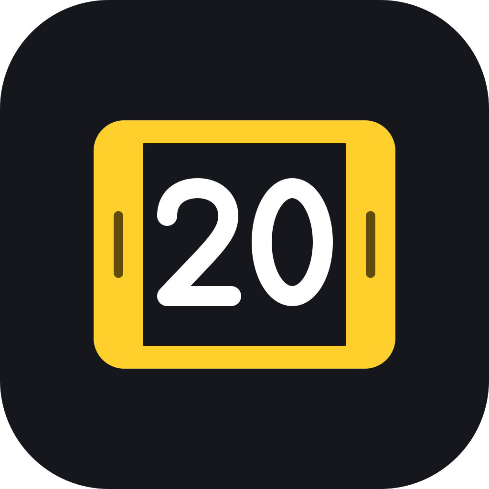

<p align="center"></p>

# Sub20

Trim a clip and get it under 20 MB, ready for Discord.

I kept cutting clips and re-encoding them by hand to fit under Discord's upload
limit, so I made one app that does both. Drop videos in, trim each one with two
handles, pick a size, and every result comes out under it. Encoding runs on the
GPU when there is one (NVIDIA, Intel, AMD or Apple), and each result is
measured: one that lands even a byte over the limit is encoded again until it
fits. Hence the name: whatever you send comes out sub 20.

Sub20 is a native desktop app: a Rust engine that drives FFmpeg, in a
[Tauri](https://tauri.app) window. It's free and open source, with no
account, no upload and no ads.

## What it does

- **Fits a size.** Bitrates are worked out from the size limit and the length
  of the kept part. Each result is measured, and one that lands over the limit
  is encoded again at a lower bitrate (up to two more times) until it fits.
  If a GPU encoder still can't get under, the CPU encoder takes over. A file
  over the limit is never saved; you get a message saying what to change.
- **Trim before compressing.** Step through the videos; each has a filmstrip
  timeline with a left and a right handle. Only the part between them is
  compressed, and the bitrate budget is spent on that part alone.
- **H.264, HEVC and AV1** on NVIDIA NVENC, Intel Quick Sync, AMD AMF, Windows
  Media Foundation, Apple VideoToolbox, Linux VAAPI, or the CPU (x264, x265,
  SVT-AV1). Every encoder is tested with a real encode at startup. Jobs use
  the best one that works and fall back to the CPU if a GPU encoder fails
  mid-job.
- **Straight into Discord.** A finished video is one Ctrl+C away from the
  clipboard, so Ctrl+V in Discord attaches it, or drag it from the window
  straight into a channel. The preview switches to the result so you can
  check it first.
- **Sizes named after Discord's limits**: 20 MB (free, the default), 50 MB
  (Nitro Basic), 100 MB (a level 3 server boost) and 500 MB (Nitro), or any
  size you type.
- **Automatic resolution.** When the limit is too tight for the source
  resolution, the picture is scaled to the size that will look best, and the
  app tells you how it will look before you compress. Trimming shorter never
  makes that verdict worse. Portrait videos are treated the same as landscape
  ones.
- **A queue** with live progress, time left, per-video cancel, and the FFmpeg
  log one click away.
- **Keeps your microphone.** OBS and the NVIDIA app can record the game and
  the mic on separate tracks; every track is mixed into the result.
- **Options**: resolution, frame-rate cap, Opus/AAC/no sound, speed against
  quality, MP4 or MKV, fixed bitrate, sound only, saved profiles.
- **Watch a folder** and compress whatever appears in it.
- **History** of what was compressed and what it shrank to.

## Requirements

- [FFmpeg](https://ffmpeg.org) 6 or newer, with `ffprobe`. The app looks on
  `PATH`, in the usual install folders, and in a folder you choose in
  Settings. To ship FFmpeg inside the app, see [Bundling FFmpeg](#bundling-ffmpeg).
- To build: [Rust](https://rustup.rs) 1.80+, Node.js 20+, and the
  [Tauri prerequisites](https://tauri.app/start/prerequisites/) for your system
  (WebView2 on Windows, Xcode command line tools on macOS, WebKitGTK 4.1 on
  Linux).

## Build and run

```bash
npm install
npm run tauri dev      # run with live reload
npm run tauri build    # make an installer for this system
```

`npm run tauri build` writes installers to `target/release/bundle/` (`.msi`
and `.exe` on Windows, `.dmg` and `.app` on macOS, `.deb`, `.rpm` and
`.AppImage` on Linux).

To work on the interface alone, `npm run dev` opens it in a browser at
`http://localhost:1420` with invented clips and simulated encodes. Add
`?clips` to the address to start with the demo clips loaded, and
`?frame=overlay` or `?frame=native` to see the macOS or Linux window frame
instead of the Windows one.

### Bundling FFmpeg

Put `ffmpeg` and `ffprobe` (with `.exe` on Windows) in `src-tauri/ffmpeg/` and
add this to the `bundle` section of `src-tauri/tauri.conf.json`:

```json
"resources": ["ffmpeg/*"]
```

The app prefers a bundled FFmpeg over one on `PATH`. Check the licence of the
FFmpeg build you ship: builds with x264 and x265 are GPL.

## Using it

1. Drop videos on the window, or click to choose them. You can also start the
   app with files: `sub20 clip1.mp4 clip2.mov`.
2. For each video, drag the yellow handles to keep the part you want. The row
   under the timeline says what will come out and how it should look.
3. Click the size at the bottom left to change it (20 MB to start).
4. Press **Compress**.
5. When it is done, press Ctrl+C and paste into Discord, or drag the file
   from under the timeline into a channel.

Results are saved next to the originals as `name-20mb.mp4`, or in one folder.
To name a result yourself, double-click it in the list (or press F2 or `r`);
a finished file is renamed on disk.

**Replace the original** (Settings, Where results go) puts the result where
the original was, under the original's name or the one you gave it, and
moves the original to the Recycle Bin (Trash on macOS) so it can be put back.
The result is saved before the original is moved, so a failure never loses
either. Watched folders always save beside the original.

### Keys

Vim motions work everywhere outside text fields, and a number in front
repeats one (`5l`, `3j`, `2G`). Press `?` in the app for this list.

| Keys | Does |
| --- | --- |
| `j` `k`, ↓ ↑ | Next or previous video |
| `gg` `G` | First or last video (`5G`: the fifth) |
| `h` `l`, ← → | Playhead back or forward 0.1 s |
| `b` `w`, `H` `L` | Playhead back or forward 1 s |
| `0` `$` | Playhead to the start or end of the kept part |
| `i` `o` (or `[` `]`) | Set the start or end at the playhead |
| Space | Play or pause the kept part |
| `r`, `cw`, F2 | Rename the result |
| `x`, `dd`, Delete | Remove the video from the list |
| `y`, Ctrl/⌘ + C | Copy the finished video, ready to paste into Discord |
| Ctrl/⌘ + Enter | Compress |
| `?` | Show the keys |

With a trim handle focused, the arrow keys move that handle.

## How it is put together

```
crates/core     sub20-core: the engine. No GUI code.
  probe.rs        read a file's facts with ffprobe
  plan.rs         size limit → bitrates, resolution, frame rate
  encoders.rs     the 21 encoders the app knows
  hardware.rs     test which of them work here
  command.rs      build the FFmpeg command line
  engine.rs       the queue: run, report, cancel, fall back, retry
  watch.rs        folder watch
  thumbs.rs       filmstrip and preview frames
  settings.rs     settings and profiles (JSON)
  history.rs      history (JSON)
src-tauri       the desktop shell: commands, events, file access
src             the interface (Svelte 5, TypeScript)
```

The engine talks to the world through one trait, `EventSink`, so it can be
used from a command-line tool or a server as easily as from the window.

## Tests

```bash
cargo test --workspace
```

Unit tests cover the planner, command builder, probe parser, settings, history
and folder scan. `crates/core/tests/e2e.rs` runs real FFmpeg encodes: fitting a
target, trimming, HEVC, AV1, two-pass, the over-the-limit retry, cancel,
CPU fallback, queue order, and the folder watch. Those are skipped when FFmpeg
is not installed.

## Design choices

- **A desktop app, not a service.** No upload step and no login. Files are
  read and written where they are.
- **Results are held to the limit.** Any overshoot, even by a byte, triggers
  another encode, so the size presets can be round numbers rather than ones
  like 9.7 MB that leave room. 1 MB is 1024 × 1024 bytes, the unit
  Discord's documentation gives its limit in.
- **"Best" effort keeps the limit.** The top setting uses the slowest preset
  and, on x264 and x265, two passes, and still aims at the size. It never
  switches to a constant-quality mode that would ignore it.
- **Audio gives way on tight budgets.** If the sound would take more than a
  third of the bitrate, it is lowered; if the limit is impossible for the
  length, the app says so instead of producing a file over the limit.
- **Hardware decoding** is a single switch that asks FFmpeg for any available
  decoder and retries on the CPU if it fails.

## What has and has not been tested

The engine was first built and tested on Linux x86-64 with FFmpeg 6.1: all unit
and end-to-end tests, and the app itself launched, trimmed and compressed real
files. On Windows 11 with FFmpeg 9.0 and an NVIDIA RTX GPU, every test passes,
including NVENC jobs. NVIDIA's H.264 encoder cannot go below roughly 600 kbps
at 720p, so when a limit is too tight for it the job switches to the CPU
encoder rather than save a file over the limit. The other hardware encoder
paths (Quick Sync, AMF, Media Foundation, VideoToolbox, VAAPI) use common
FFmpeg settings for those encoders but have only been exercised through their
failure-and-fallback path so far. The app window has not been run on Windows
or macOS yet.

## Coming next

- FFmpeg bundled in the app, so it works straight after install.
- Downloads on the [Releases](../../releases) page, with and without FFmpeg
  bundled.

## Licence

[MIT](LICENSE): use it, change it and share it, for anything.

Inspired by [8mb.local](https://github.com/JMS1717/8mb.local) by JMS1717.

Sub20 is not affiliated with or endorsed by Discord. "Discord" names the
service the size presets are made for.

## Contributing

Bug reports, test results from Intel, AMD and Apple GPUs, and pull requests
are welcome. See [CONTRIBUTING.md](CONTRIBUTING.md), and
[SECURITY.md](SECURITY.md) for security problems.
